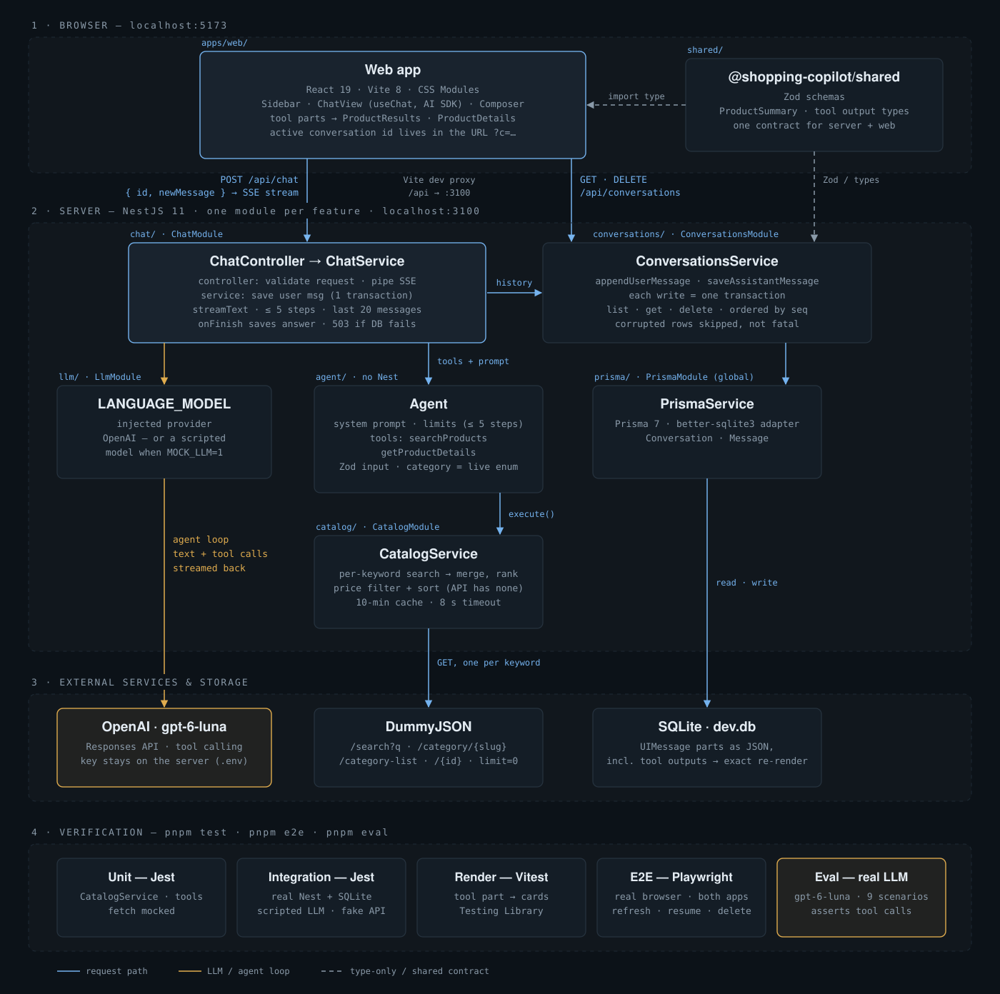

# Shopping Copilot

A chat assistant that helps you find products from the DummyJSON catalog. You type what you want, it searches, and the results show up as product cards inside the chat.



## Setup and run

You need Node 22+ and pnpm 10+.

```bash
pnpm install
cp apps/server/.env.example apps/server/.env   # put your OPENAI_API_KEY in there
pnpm dev                                      # server on :3100, web on :5173
```

Then open http://localhost:5173. The SQLite DB gets created automatically on the first `pnpm dev`.

## Architecture & framework choice

I went with **NestJS + Vercel AI SDK** on the server, **React + Vite** on the client, and **Prisma + SQLite** for storage, all in a pnpm monorepo. There's also a `shared/` package with the Zod schemas that both sides use.

I picked the AI SDK because it's thin. It gives me the tool-calling loop (`streamText`) and a streaming format where tool results come in as typed message parts. On the client, `useChat` reads that stream, so rendering product cards is basically a `switch` on the part type. Everything else (prompt, tools, persistence) is my own code. NestJS and Prisma are what I use at work, so I know them well.

What I considered and dropped:
- **LangChain.** My agent is one model, two tools and a short loop. LangChain would add a lot of layers on top of that, and it doesn't help with streaming tool results into React, which was the part I actually needed. I'd end up writing that bridge myself anyway.
- **From scratch with the plain OpenAI SDK.** I seriously thought about this one. But I'd have to write the tool loop, a streaming protocol and the client-side state for it myself. The AI SDK covers that without hiding anything important.
- **OpenAI Decisions API.** Not needed. The tool schema already forces typed choices: the category is an enum, sort is an enum, prices are numbers. A separate "classify first" call would add another model call to every message.
- **Next.js.** I wanted a separate API and UI. The agent, tools and persistence all live in the Nest server, and the web app is just a chat client.
- **Tailwind.** The UI is small (a sidebar, a message list, an input and the product cards), so I just wrote plain CSS with CSS Modules. Tailwind would add a setup step and a styling layer for very little gain.

## Retrieval strategy

First I poked at the API a bit and found a few problems:
- `/products/search?q=` is a plain substring match. "shoes" gives 4 results, "running shoes" gives 0.
- There's no price filter anywhere.
- The whole catalog is only ~200 products in 24 categories.

So instead of letting the model hit endpoints directly, I gave it **one `searchProducts` tool with filters**: keywords, category, min/max price, sort and limit. My code (`CatalogService`) then decides which endpoint to call:
- **category given** → `/products/category/{slug}?limit=0`, then filter by keywords locally.
- **only keywords** → `/products/search?q=<word>&limit=0`, **once per word**. Then I merge the results, remove duplicates and rank them (more matching words = higher, title matches count more).
- **neither** → `/products?limit=0`.
- In all cases, price filtering and sorting happen in my code.

There's also `getProductDetails` (`/products/{id}`) for follow-ups like "tell me more about the first one".

The categories come from `/products/category-list` when the server starts. They go into the system prompt and into the tool schema as an enum, so the model can't invent a category. `limit=0` (fetch everything) is fine because the catalog is tiny. Responses are cached for 10 minutes.

How it handles the tricky cases:
- **Ambiguous ("something cheap and cool").** It doesn't refuse and doesn't ask 5 questions. It picks an interpretation (sort by price), shows results, says what it assumed, and asks one question to narrow it down. "Cool" isn't really understood, so you often get cheap groceries.
- **Off-catalog ("a flight to Tokyo").** No tool call. It says it can't do that and suggests something relevant from the store, like a travel bag.
- **Multi-intent ("a laptop and a lipstick").** It runs a separate search for each one, and each gets its own card grid.
- **Follow-ups ("any cheaper ones?").** Tool results are saved in the history, so the model knows what it already showed and searches again with a price sort.

A bug I found with the eval: the model kept sending `maxPrice: 0` to mean "no limit", which returned zero products. Now those fields are nullable, and 0/null are treated as "not set".

## Conversation & state

Everything lives **on the server in SQLite**. The browser only keeps the current conversation id in the URL (`?c=...`).

Each message is stored as the AI SDK message parts in JSON, including the tool results. So when you refresh, you get the exact same product cards back without calling the API again. The client only sends the new message. The server loads the history from the DB itself, so the client can't mess with the history.

Why not localStorage: it's per-browser, limited in size, the user can wipe it, and the server would have to trust history sent by the client. A SQLite file is just as easy to run locally and doesn't have those problems.

What happens when things go wrong:
- **Storage full / DB write fails.** If saving the user's message fails, the request returns 503 and **the model isn't called at all** (no point paying for an answer that disappears on refresh). Creating the conversation and saving the message happen in one transaction, so you don't get an empty chat stuck in the sidebar. If saving the *answer* fails, the user already saw it, but it'll be missing after a refresh. I only log that for now.
- **Corrupted data.** A message with broken JSON is skipped and logged, and the rest of the conversation still loads. If the saved history doesn't match the current tool schemas, the server just continues with the new message.
- **User clears browser storage.** Nothing is lost, because there's nothing important in browser storage. The id is in the URL, and all past chats are in the sidebar.
- **Chat deleted while the answer is still streaming.** The save checks that the conversation still exists (in the same transaction), so a deleted chat stays deleted.
- **DummyJSON is down.** The tool returns an error instead of crashing, the model tells the user, and the UI shows an alert.

## Evaluation

There are a few layers:
- **Unit tests (Jest).** The catalog logic with a fake `fetch`: which endpoint gets called, splitting and merging keywords, ranking, price filter, cache, outage handling, and the 0/null fix.
- **Integration test (Jest + supertest).** The real Nest app with a real SQLite DB, but a **scripted fake model** and a fake DummyJSON. It checks the whole flow: message in → tool call → products streamed → answer → saved → shows up in the list → history sent to the model on the next turn. It also covers the error cases above (503, corrupted row, outage, bad requests).
- **Component tests (Vitest).** A tool result actually renders as cards (title, price, image), plus the loading and error states.
- **E2E (Playwright).** Real browser: send a message → see cards → refresh and the chat is still there → new chat → switch back → delete.
- **LLM eval (`pnpm eval`).** The **real model** on 9 scenarios: price limits, ambiguous, off-catalog, multi-intent, category + sort, Hebrew, follow-ups. It checks *what the model decided* (which tool, which filters), not the exact wording. It fails if under 80% pass.

**What it would catch:** breaking the contract between the tool and the UI, history not saving or not loading, wrong endpoint or price filter bugs, crashes when the API is down, and prompt changes that make the model stop searching, ignore budgets, or search for flights.

**What would slip through:** whether the answer text is actually helpful (there's no LLM judge), whether the *best* products show up first (no labelled relevance data), visual/layout bugs, and small drops in model behaviour, since 9 cases run once can't tell 95% from 80%.

## Known limitations

- **Broad queries are boring.** "Cheap and cool" gives the cheapest stuff, which is usually groceries. I'd spread the results across a few categories.
- **No users or auth.** All conversations are shared by everyone.
- **A lost answer stays lost.** If the DB fails after streaming, that answer is gone after a refresh. I'd add a retry.
- **No summarizing of long chats.** Only the last 20 messages go to the model. (agent-config.ts)
- **UX basics are missing.** No cart, no compare view, no retry button.
